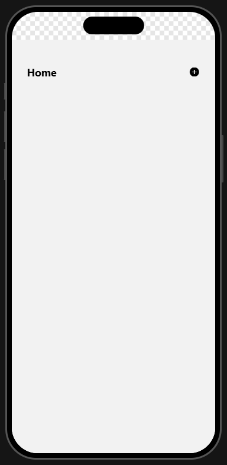
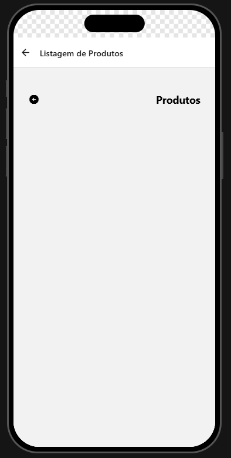
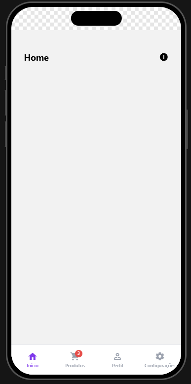
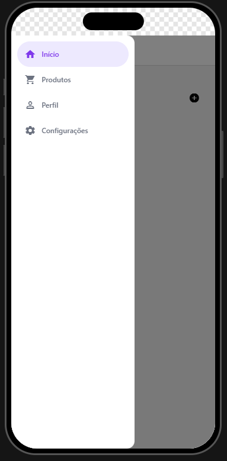

# my-app — Projeto de Navegação (React Navigation)

**Aluna:** ISABEL MARÇANO MOURA DA PAZ
**Disciplina:** Programação para Dispositivos Móveis — ADS · Senac Rio · Módulo 4 · 2026.2
**Atividade:** Ciclo Avaliativo 1 — Projeto de Navegação


## Sobre o app

Aplicativo feito para avaliação acadêmica, que demonstra os três tipos de navegação mais usados no mercado (Stack, Bottom Tabs e Drawer), . O tipo de navegação é escolhido mudando **uma única linha** em `src/routes/index.jsx`, sem alterar o código das telas.

1. **Stack** (pilha) | Empilha telas. Home → Product, com botão de voltar. 
2. **Bottom Tabs** (abas inferiores) | 4 abas: Início, Produtos (com balão vermelho "3"), Perfil (ícone muda com `focused`) e Configurações. 
3. **Drawer** (menu lateral) | Menu com 4 itens (Início, Produtos, Perfil, Configurações). Abre pelo botão ☰ ou arrastando a partir da borda esquerda. 


## Como rodar

Pré-requisito: [Node.js](https://nodejs.org/) instalado.

```bash
# 1. Instalar as dependências
npm install

# 2. Iniciar o projeto
npx expo start
```

Depois, no terminal do Expo:

- `w` abre no navegador (web)
- `a` abre no emulador/aparelho Android
- Ou escaneie o QR Code com o app **Expo Go** compatível ou pressione `a` para abrir um emulador Android já configurado. Também é possível executar `npm run web`.

Se aparecer algum erro estranho, limpe o cache com `npx expo start --clear`.


## Como trocar o tipo de navegação

Abra `src/routes/index.jsx` e altere SOMENTE o valor da constante:

```js
const TIPO_DE_NAVEGACAO = "stack";   // pilha
const TIPO_DE_NAVEGACAO = "bottom";  // abas inferiores
const TIPO_DE_NAVEGACAO = "drawer";  // menu lateral
```

Salve o arquivo; o Fast Refresh recarrega o app sozinho.


## Estrutura do projeto

```
my-app/
├── index.js
├── package.json
├── README.md
└── src/
    ├── App.jsx              <- GestureHandlerRootView
    ├── assets/
    ├── components/          <- ButtonIcon, Header, Title
    ├── routes/
    │   ├── index.jsx        <- NavigationContainer + TIPOS_DE_NAVEGACAO
    │   ├── StackRoutes.jsx
    │   ├── BottomRoutes.jsx
    │   └── DrawerRoutes.jsx
    └── screens/
        ├── Home.jsx
        ├── Product.jsx
        ├── Profile.jsx
        └── Settings.jsx
```


## Tecnologias

- Expo SDK 54 / React Native 0.81
- `@react-navigation/native`, `native-stack`, `bottom-tabs` e `drawer`
- `react-native-gesture-handler`, `react-native-reanimated`, `react-native-screens`, `react-native-safe-area-context`
- `@expo/vector-icons` (MaterialIcons)

## Prints

### Stack



### Bottom Tabs (4 abas e balão de notificação)


### Drawer (gaveta aberta)
